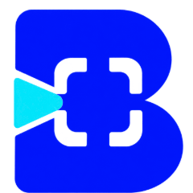
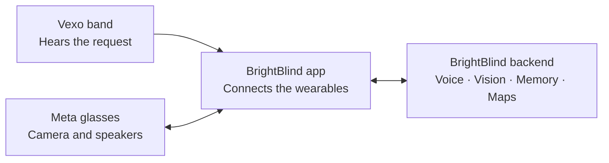

<div align="center">

<h1>
  <picture>
    <source media="(prefers-reduced-motion: reduce)" srcset="assets/readme/brightblind-symbol.png">
    
  </picture>
  BrightBlind
</h1>

**BrightBlind connects the conversations you remember with the world in front of you.**

A voice companion for blind and low vision people, built with a Vexo band, Meta glasses, and AI that brings memory, vision, and transit information into one conversation.

[The demo](#one-minute-demo) · [What it does](#what-it-does) · [Architecture](#architecture) · [Engineering](#engineering-decisions) · [Quick start](#quick-start) · [Results](#working-integrations-and-results)

<sub>Built at VexoHacks in San Francisco, November 14, 2026. Vexo · Meta glasses · Pipecat · Deepgram · Google Gemini · Google Maps.</sub>

</div>

## From the bus stop to the right bag of Doritos

A grocery trip is a series of small decisions. Which stop do I need? When does the bus leave? Where is the item? Is this the flavor someone asked me to bring?

BrightBlind carries context across those moments. Vexo captures the conversation. The glasses supply the view. The backend connects what was said with what is visible and answers aloud.

Our one minute demo makes that concrete with **Doritos**. Someone asks for a particular item. Later, the wearer holds up a bag and asks whether it matches. BrightBlind reads the label and checks it against the remembered request.

**The conversation becomes context. The camera supplies evidence. The answer brings them together.**

## One minute demo

The story is simple: remember the request, look at the product, and check whether it is the right one.

| Moment | What happens |
| :--- | :--- |
| **Hear the request** | Vexo captures the spoken context, including what someone asked for. |
| **Ask about the item** | The wearer asks, “BrightBlind, is this the one they wanted?” |
| **Look when needed** | The coordinator takes a photo or selects a fresh frame from the glasses. |
| **Compare the details** | Gemini reads the product and variant, then compares the image with remembered context in one call. |
| **Hear the answer** | Deepgram generates a short response, delivered through the glasses. If the label or memory is unclear, the answer says so. |

The same flow works with the item and context supplied at runtime. [`Providers.match`](backend/providers.py) compares the image with the request stored by [`Memory`](backend/memory.py).

The broader [video storyboard](docs/demo-video-script.md) covers the journey from home to the store and back.

## What it does

Say **“BrightBlind”** to get its attention, then ask your question. It replies through the glasses, so you can keep your hands free.

| Ask BrightBlind | Information it uses | What it returns |
| :--- | :--- | :--- |
| “What am I holding?” | A camera image | Visible product names, labels, and variants. |
| “Is this what they asked for?” | The image and saved conversation context | A comparison with the remembered request, including uncertainty. |
| “Where is the food?” | Selected frames from the glasses | A description of the target's position in the camera view. |
| “Where is the exit?” | Door and exit-sign observations | The visible target's position, or a request for a clearer view. |
| “Which bus should I take?” | A starting address, destination, and Google Maps | A transit route, departure stop, line, and departure estimate. |
| “When is the next bus?” | A refreshed Maps request for the saved route | Minutes until the returned departure estimate. |
| “What is in my way?” | Visible objects in the camera view | Potential obstacle descriptions, including chairs, bags, boxes, stairs, and curbs. |
| “What did they ask me to bring?” | Captured speech and memory | An answer grounded in the recorded context. |

## Why two wearables make the difference

**Vexo handles the ongoing listening. Meta glasses provide the eyes and the voice.**

That division matters for both interaction and power. The band keeps the conversation available to the assistant, while the glasses can be called on for a specific visual task or spoken answer.

| Wearable | Published battery rating | Role in BrightBlind |
| :--- | :--- | :--- |
| **Vexo Band** | **Up to 4 days** of continuous listening, according to [Vexo](https://www.vexoai.com/). | Capture speech, gestures, and the context behind a request. |
| **Ray-Ban Meta Gen 1** | **Up to 3 hours** of continuous audio streaming and voice assistance, according to [Ray-Ban](https://www.ray-ban.com/usa/c/frequently-asked-questions-ray-ban-meta-smart-glasses). | Capture a useful view and deliver the answer through the speakers. |

These are manufacturer ratings for the stated usage modes. They explain the architecture: **keep the listening workload on the band and use the glasses' camera deliberately.**

BrightBlind supports camera activation on demand. For rapid follow-up questions, `WARM_STREAM=1` keeps a stream ready so the next request can use a fresh frame immediately. The coordinator controls when to look, when to reuse a view, and when to stop.

## Architecture

**Two wearables, one connection app, one backend.**



1. **You ask.** Vexo sends the spoken request through the connection app.
2. **BrightBlind decides what it needs.** Pipecat coordinates the voice workflow, and Deepgram transcribes the speech. The backend selects vision, memory, or transit information.
3. **The right information comes back.** If a view is needed, the backend asks the glasses for a photo or stream. Gemini analyzes the image and context; Google Maps provides route and departure estimates when requested.
4. **You hear the answer.** Deepgram generates speech, and the app plays it through the glasses.

The diagram shows the native phone app path. In the laptop setup, the laptop forwards the band's audio directly to the same backend while the iPhone connects the glasses. The backend's responsibilities stay the same.

<details>
<summary><strong>What runs inside the backend</strong></summary>

| Component | Responsibility | Source |
| :--- | :--- | :--- |
| Planner | Select vision, item comparison, transit, exit finding, or memory. Obvious commands can route directly. | [`providers.py`](backend/providers.py), [`coordinator.py`](backend/coordinator.py) |
| Vision and Guide | Inspect selected images, locate a target in the view, and ask for another view when needed. | [`providers.py`](backend/providers.py) |
| Transit | Fetch a route and departure estimate, refresh timing, and schedule a bus-view check. | [`providers.py`](backend/providers.py), [`transit_speech.py`](backend/transit_speech.py) |
| Recall memory | Keep speech and visual notes with activity context, distill memories, and answer remembered questions. | [`memory.py`](backend/memory.py) |
| Voice | Recognize speech, generate audio, handle interruptions, and encode replies for the glasses. | [`voice.py`](backend/voice.py) |

The dashboard shows selected frames and the work behind the answer. Session logs record agent events and timing; they are stored in the configured data directory, not in the repository.

</details>

## Engineering decisions

### Keep the conversation moving while the camera works

Camera capture, model inference, and transit requests take different amounts of time. The coordinator runs slower work separately from the voice connection, allowing a short acknowledgement while the result is being prepared.

Requests carry identifiers and generation checks. A late photo or model result should not become the answer to a newer question. Streaming analysis is bounded so frames do not accumulate into a stale queue.

### Ask the model once when one call is enough

For the Doritos interaction, the image and remembered request go into the same Gemini call. The model can identify the item and compare the variant without separate “what is this?” and “is it right?” round trips.

Gemini calls default to `GEMINI_THINKING_LEVEL=LOW`. Explicit bus, food, and label requests can route without a planner-model call. The scene facts still come from the image or provider response.

### Optimize the audio the app actually plays

The current glasses contract accepts complete audio clips. Flux can produce its first audio quickly, but waiting for its entire clip introduced a noticeable delay in this setup.

We compared real Deepgram services through Pipecat. For the same diagnostic sentence, median generation of complete speech clips was **6.6 seconds with Flux WebSocket** and **2.1 seconds with Aura HTTP**, across three calls per service. That is why Aura HTTP is the current default. **That is a 68% reduction in median speech generation time for this benchmark.**

### Avoid a new shutter request when a fresh frame exists

The coordinator can use a recent frame from an active stream instead of asking the glasses to capture another still. If the stream is running but the cached frame is old, it waits for a new frame.

The two camera modes serve different needs: activation on demand for occasional questions, and a warm stream for repeated visual checks. An explicit stop turns the warm stream off.

## Working integrations and results

BrightBlind uses real provider APIs. The records below show what each part of the system returned.

| Integration | Result | Record |
| :--- | :--- | :--- |
| **Pipecat + Deepgram** | Speech API tests produced recognized text and generated MP3 audio through the Pipecat pipeline. | [`verification.json`](backend/verification.json) |
| **Meta glasses + Gemini + Deepgram** | A connected glasses camera returned a photo, Gemini produced an observation, and generated speech was delivered back to the device app. | [`railway-camera-verification.json`](backend/railway-camera-verification.json) |
| **Google Maps** | A live San Francisco transit request returned line 5, its departure stop, and a departure estimate. | [`maps-verification.json`](backend/maps-verification.json) |
| **Gemini LOW thinking** | A structured classification request completed in approximately **1.7 seconds**. | [`low-thinking-verification.json`](backend/low-thinking-verification.json) |
| **Speech generation** | Median complete speech generation fell from **6.6 seconds to 2.1 seconds** when we selected Aura HTTP for the existing audio format. | [`speech-latency-benchmark.json`](backend/speech-latency-benchmark.json) |

The speech comparison used the same diagnostic text and three live requests per engine through Pipecat. The linked records retain the inputs, timing scope, and results of each check.

## Quick start

### Start the backend

Requires Python 3.12. The current speech encoder uses `ffmpeg` when available and has a PyAV fallback.

```sh
git clone https://github.com/ismaelmehdid/BrightBlind.git
cd BrightBlind/backend
uv venv .venv --python 3.12
uv pip install --python .venv/bin/python -r requirements.txt
cp .env.example .env
```

Set the provider keys and relay tokens in `.env`, then run:

```sh
.venv/bin/python server.py
```

Open [the local dashboard](http://127.0.0.1:8765). The device WebSocket endpoint is `ws://127.0.0.1:8765/ws`. A phone needs a reachable host address or authenticated HTTPS endpoint; its own `localhost` is not the laptop.

### Connect real hardware

* **Phone hub:** [`mobile/`](mobile/) contains the Expo app and native Meta glasses module. Hardware use needs a native development build; Expo Go alone does not provide the custom Meta module. See the [native build workflow](.github/workflows/mobile-ios.yml).
* **Glasses app:** [`ios/README.md`](ios/README.md) covers the standalone Swift app, SDK registration, permissions, signing, and camera modes.
* **Laptop band path:** the event's `vexo-open-kit/` checkout is required. [`app.py`](app.py) owns the band connection and forwards audio and events through [`recall/relay.py`](recall/relay.py). Set `BACKEND_WS_URL` to the backend's authenticated band URL. Do not run a second process against the same band.

For spoken requests, use **“BrightBlind, …”**. With `REQUIRE_WAKE_WORD=1`, unaddressed speech can be remembered without causing a camera request or spoken reply. The name alone opens a short window for the next sentence; a double tap also opens a request window.

### Configure services

| Variable | Purpose |
| :--- | :--- |
| `DEEPGRAM_API_KEY` | Flux speech recognition and Deepgram speech output through Pipecat. |
| `GEMINI_API_KEY` | Gemini vision, planning, item comparison, and memory. |
| `GOOGLE_MAPS_API_KEY` | Routes API transit requests; Maps requires its own enabled API and suitable credentials. |
| `GEMINI_MODEL`, `GEMINI_THINKING_LEVEL` | Default: `gemini-4-hydrogen`, `LOW`. |
| `DEEPGRAM_TTS_ENGINE`, `DEEPGRAM_AURA_VOICE` | Default: `aura_http`, `aura-2-thalia-en`. |
| `BAND_RELAY_TOKEN`, `GLASSES_RELAY_TOKEN` | Separate credentials for the two device roles. |
| `DASHBOARD_TOKENS` | Access to protected dashboard data and commands. |
| `LIVE_ONLY` | Default `1`: require the relevant real device connection and configured providers. |
| `REQUIRE_WAKE_WORD` | Set `1` to require the spoken name or an opened request window. |
| `WARM_STREAM` | Optional `1` keeps the camera ready between requests at the cost of additional camera use. |
| `BACKEND_DATA_DIR` | SQLite memory, events, and session logs; use persistent storage in a deployment. |

ElevenLabs is an optional speech provider, not a requirement for the default workflow. See [`backend/.env.example`](backend/.env.example) for the full configuration. Never commit keys, private relay URLs, recordings, or session data.

### Deploy

The coordinator's deployment root is **`backend/`**, using [`backend/Dockerfile`](backend/Dockerfile) and `/healthz`. Configure secrets in the hosting environment and use persistent storage for the data directory.

The [backend setup guide](backend/README.md) and [Compose configuration](backend/compose.yaml) cover deployment. [`DEPLOY.md`](DEPLOY.md) describes the separate Recall service. The repository's root Dockerfile is for that service, not the coordinator.

## Repository structure

```text
backend/                 Pipecat voice pipeline, agents, memory, dashboard and tests
ios/                     Standalone Swift glasses app using Meta DAT 1.0.1
mobile/                  Expo app with native glasses and band integrations
recall/                  Laptop memory service, band relay and cloud fallback
app.py                   Laptop entry point for the Vexo band
run_backend_local.py     Local launcher using the root environment file
docs/                    Demo storyboard and project notes
sponsor-docs/            Provider setup and technical references
.github/workflows/       Recall deployment and native app builds
```

## Tests

From `backend/`:

```sh
.venv/bin/python -m unittest discover -v
```

Automated tests cover message contracts, authentication, capture correlation, stale results, speech encoding, transit timing, and obstacle descriptions. Isolated fixtures keep those checks repeatable; the live provider and device checks are recorded separately above.

## Built around evidence and clear answers

* **Context stays connected.** Product comparisons use captured requests and visible labels together.
* **Timing comes from the source.** Bus departure estimates come from Google Maps and are refreshed when requested.
* **Fresh views matter.** Capture identifiers and stale-result checks keep an older observation from answering a newer question.
* **Uncertainty leads to a useful next step.** The assistant can ask for a clearer view or more context instead of inventing a missing detail.
* **Access is explicit.** Separate relay credentials and protected dashboard endpoints keep device and operator connections scoped.

BrightBlind supports awareness alongside a cane, guide dog, or other established mobility aid. Visual descriptions and transit estimates do not certify safe clearance, foot placement, or boarding.

The backend coordinates one wearer session, with separate band, glasses, and dashboard connections.

## Development notes

Coordinate work through the existing [team board](https://github.com/ismaelmehdid/BrightBlind/issues/2). Keep changes focused to the assigned component and agree on device-contract changes before implementing them. The contract below remains the common reference for the two relays.

<details>
<summary><strong>WebSocket contract v0</strong></summary>

One server, path `/ws`. Every message is a JSON text frame: `{"type": "...", "ts": <ms since epoch>, ...}`. Binary payloads are base64 inside JSON for now (simple beats fast today). First message from any client is `hello`.

Client → backend:

| type | from | fields |
|---|---|---|
| `hello` | both | `client: "band" \| "glasses"`, `caps: [...]` |
| `audio` | band | `seq`, `opus_b64` (one 20 ms packet) or `pcm_b64` (16 kHz s16le) |
| `event` | band | `kind: "tap" \| "double-tap" \| "free-fall" \| "tilt"` |
| `activity` | band | `state: "still" \| "walk" \| "run"`, `steps`, `cadence` |
| `photo` | glasses | `jpeg_b64`, `w`, `h`, `source: "capture" \| "stream"`, `req_id` |
| `frame` | glasses | `jpeg_b64`, `w`, `h`, `seq` (sampled stream frame) |
| `state` | glasses | `glasses: "disconnected" \| "connected" \| "streaming"`, `battery` |
| `button` | glasses | `press: "short" \| "double" \| "hold"` |

Backend → client:

| type | to | fields |
|---|---|---|
| `capture` | glasses | `req_id`, `quality: "medium" \| "full"` |
| `stream` | glasses | `on: true \| false`, `fps` (sampled frames per second to send, 1–2) |
| `say` | glasses | `text` and/or `audio_b64` (mp3), `interrupt: true \| false` |
| `stop_speaking` | glasses | |
| `led` | band | `color: "#rrggbb"` |

If you need a field that is not here, add it to this table in the same commit as the code.

</details>

<details>
<summary><strong>Scaffold and hardware notes</strong></summary>

The Meta integration began from the public [glasses-tutor scaffold](https://github.com/andriidrok1/glasses-tutor) and uses Meta's Device Access Toolkit 1.0.1. The band integration uses the event's `vexo-open-kit`.

Native SDK signatures and permissions must be checked against the version in the project. Streaming and standalone photo modes have different startup and transfer behavior. Existing internal bundle identifiers, URL schemes, and build target names may retain their original names for compatibility.

</details>
