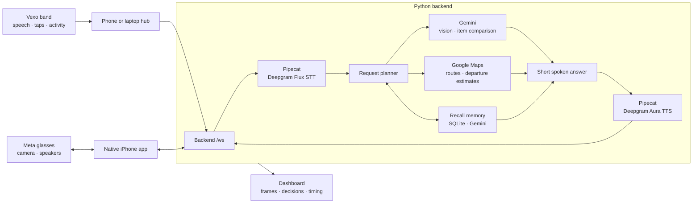

<div align="center">

# BrightBlind

**A wearable assistant that remembers what you heard, reads what you see, and answers through your glasses.**

[The demo](#one-minute-demo) · [What it does](#what-it-does) · [Architecture](#architecture) · [Engineering](#engineering-decisions) · [Quick start](#quick-start) · [Evidence](#what-we-verified)

<sub>Built at VexoHacks in San Francisco, November 14, 2026. Vexo · Meta glasses · Pipecat · Deepgram · Google Gemini · Google Maps.</sub>

</div>

## Why we built it

A trip to the grocery store starts before you reach the shelf. There is a route to plan, a bus stop to find, a bus number to confirm, and a product to pick from several similar packages.

For someone who is blind or has low vision, information along that journey can be difficult to access visually. We wanted to make asking about it feel as natural as asking someone beside you.

BrightBlind connects the things a wearer hears, sees through the glasses, and needs to remember. Our one minute demo focuses on a bag of **Doritos**: a familiar object that brings the whole interaction into focus.

## One minute demo

The story is simple: remember the request, look at the product, and check whether it is the right one.

| Moment | What happens |
| :--- | :--- |
| **Hear the request** | Vexo captures the spoken context, including what someone asked for. |
| **Ask about the item** | The wearer asks, “BrightBlind, is this the one they wanted?” |
| **Look when needed** | The coordinator takes a photo or selects a fresh frame from the glasses. |
| **Compare the details** | Gemini reads the product and variant, then compares the image with remembered context in one call. |
| **Hear the answer** | Deepgram generates a short response, delivered through the glasses. If the label or memory is unclear, the answer says so. |

The item comparison lives in [`Providers.match`](backend/providers.py); remembered context comes from [`Memory`](backend/memory.py). Doritos is the demo subject, not a preset product answer.

The broader [video storyboard](docs/demo-video-script.md) covers the journey from home to the store and back.

## What it does

| Ask BrightBlind | Information it uses | What it returns |
| :--- | :--- | :--- |
| “What am I holding?” | A camera image | Visible product names, labels, and variants. |
| “Is this what they asked for?” | The image and saved conversation context | A comparison with the remembered request, including uncertainty. |
| “Where is the food?” | Selected frames from the glasses | A description of the target's position in the camera view. |
| “Where is the exit?” | Door and exit-sign observations | The visible target's position, or a request for a clearer view. |
| “Which bus should I take?” | A starting address, destination, and Google Maps | A transit route, departure stop, line, and departure estimate. |
| “When is the next bus?” | A refreshed Maps request for the saved route | Minutes until the returned departure estimate. |
| “What is in my way?” | Visible objects in the camera view | Potential obstacle descriptions, including chairs, bags, boxes, stairs, and curbs. |
| “What did they ask me to bring?” | Captured speech and memory | An answer grounded in the recorded context. |

**Visual information is assistance, not a guarantee of safe movement.** A visible bus number does not authorize boarding. A photo of stairs does not establish where to put a foot. BrightBlind is intended to complement a cane, guide dog, or other established mobility support.

### Why Vexo matters

Vexo is the listening and memory side of the system. The glasses provide the camera and spoken output. This separation lets the assistant keep useful context without requiring a continuous glasses camera stream.

The camera can run only when a task needs it. For a faster demonstration, `WARM_STREAM=1` deliberately keeps the stream ready between requests. That trades camera activity for lower capture delay. **Battery savings have not yet been measured on the hardware.**

## Architecture



**Pipecat and Deepgram are on the actual voice path.** Deepgram Flux transcribes band audio; Pipecat carries the request through the backend; Deepgram Aura generates the spoken response. Gemini handles visual reasoning and memory tasks. Google Maps supplies transit data.

The native app carries images and audio between the glasses and backend. The Vexo band can connect through the native phone integration or through the laptop's Recall process. One process should own the band's connection at a time.

### The agents

| Component | Responsibility | Source |
| :--- | :--- | :--- |
| Planner | Select vision, item comparison, transit, exit finding, or memory. Obvious commands can route directly. | [`providers.py`](backend/providers.py), [`coordinator.py`](backend/coordinator.py) |
| Vision and Guide | Inspect selected images, locate a target in the view, and ask for another view when needed. | [`providers.py`](backend/providers.py) |
| Transit | Fetch a route and departure estimate, refresh timing, and schedule a bus-view check. | [`providers.py`](backend/providers.py), [`transit_speech.py`](backend/transit_speech.py) |
| Recall memory | Keep speech and visual notes with activity context, distill memories, and answer remembered questions. | [`memory.py`](backend/memory.py) |
| Voice | Recognize speech, generate audio, handle interruptions, and encode replies for the glasses. | [`voice.py`](backend/voice.py) |

The dashboard shows selected frames and the work behind the answer. Session logs record agent events and timing; they are stored in the configured data directory, not in the repository.

## Engineering decisions

### Keep the conversation moving while the camera works

Camera capture, model inference, and transit requests take different amounts of time. The coordinator runs slower work separately from the voice connection, allowing a short acknowledgement while the result is being prepared.

Requests carry identifiers and generation checks. A late photo or model result should not become the answer to a newer question. Streaming analysis is bounded so frames do not accumulate into a stale queue.

### Ask the model once when one call is enough

For the Doritos interaction, the image and remembered request go into the same Gemini call. The model can identify the item and compare the variant without separate “what is this?” and “is it right?” round trips.

Gemini calls default to `GEMINI_THINKING_LEVEL=LOW`. Explicit bus, food, and label requests can route without a planner-model call. The scene facts still come from the image or provider response.

### Optimize the audio the app actually plays

The current glasses contract accepts complete audio clips. Flux can produce its first audio quickly, but waiting for its entire clip introduced a noticeable delay in this setup.

We compared real Deepgram services through Pipecat. For the same diagnostic sentence, median complete-clip generation was **6.6 seconds with Flux WebSocket** and **2.1 seconds with Aura HTTP**, across three calls per service. That is why Aura HTTP is the current default. It is a speech-generation measurement, not a claim about complete response time.

### Avoid a new shutter request when a fresh frame exists

The coordinator can use a recent frame from an active stream instead of asking the glasses to capture another still. If the stream is running but the cached frame is old, it waits for a new frame.

The tradeoff is power use. A warm stream is useful for quick follow-up questions, while camera activation on demand is the more conservative operating mode. An explicit stop turns the warm stream off.

## What we verified

These are recorded engineering checks from November 14. They distinguish live provider calls, a connected-glasses test, and isolated test fixtures.

| Check | Recorded result | Evidence |
| :--- | :--- | :--- |
| Deepgram through Pipecat | Real Flux STT transcribed a diagnostic phrase. Real speech output produced an MP3 that was transcribed back successfully. Wearable inputs were simulated in that engineering check. | [`verification.json`](backend/verification.json) |
| Connected glasses and cloud AI | An approved typed request returned a photo from the connected glasses, produced a Gemini observation, and sent Deepgram audio back to the glasses app. | [`railway-camera-verification.json`](backend/railway-camera-verification.json) |
| Google Maps | The live Routes API returned a San Francisco transit route; the backend extracted line 5 and its departure stop. | [`maps-verification.json`](backend/maps-verification.json) |
| Gemini LOW | A real structured classification call accepted LOW thinking and completed in about 1.7 seconds. | [`low-thinking-verification.json`](backend/low-thinking-verification.json) |
| Speech output comparison | Three calls per service: 6.6 s versus 2.1 s median complete-clip generation. | [`speech-latency-benchmark.json`](backend/speech-latency-benchmark.json) |

The recorded connected-glasses check returned its observation at **5.8 seconds** and sent the answer audio at **10.8 seconds**. It preceded the newer speech and stream-reuse changes. Those numbers are historical measurements, not the claimed latency of the latest build. Audio delivery to the app is also not a measurement of when the wearer heard it.

## Quick start

### Start the backend

Requires Python 3.12. The current speech encoder uses `ffmpeg` when available and has a PyAV fallback.

```sh
git clone https://github.com/ismaelmehdid/BrightBlind.git
cd BrightBlind/backend
uv venv .venv --python 3.12
uv pip install --python .venv/bin/python -r requirements.txt
cp .env.example .env
```

Set the provider keys and relay tokens in `.env`, then run:

```sh
.venv/bin/python server.py
```

Open [the local dashboard](http://127.0.0.1:8765). The device WebSocket endpoint is `ws://127.0.0.1:8765/ws`. A phone needs a reachable host address or authenticated HTTPS endpoint; its own `localhost` is not the laptop.

### Connect real hardware

* **Phone hub:** [`mobile/`](mobile/) contains the Expo app and native Meta glasses module. Hardware use needs a native development build; Expo Go alone does not provide the custom Meta module. See the [native build workflow](.github/workflows/mobile-ios.yml).
* **Glasses app:** [`ios/README.md`](ios/README.md) covers the standalone Swift app, SDK registration, permissions, signing, and camera modes.
* **Laptop band path:** the event's `vexo-open-kit/` checkout is required. [`app.py`](app.py) owns the band connection and forwards audio and events through [`recall/relay.py`](recall/relay.py). Set `BACKEND_WS_URL` to the backend's authenticated band URL. Do not run a second process against the same band.

For spoken requests, use **“BrightBlind, …”**. With `REQUIRE_WAKE_WORD=1`, unaddressed speech can be remembered without causing a camera request or spoken reply. The name alone opens a short window for the next sentence; a double tap also opens a request window.

### Configure services

| Variable | Purpose |
| :--- | :--- |
| `DEEPGRAM_API_KEY` | Flux speech recognition and Deepgram speech output through Pipecat. |
| `GEMINI_API_KEY` | Gemini vision, planning, item comparison, and memory. |
| `GOOGLE_MAPS_API_KEY` | Routes API transit requests; Maps requires its own enabled API and suitable credentials. |
| `GEMINI_MODEL`, `GEMINI_THINKING_LEVEL` | Default: `gemini-4-hydrogen`, `LOW`. |
| `DEEPGRAM_TTS_ENGINE`, `DEEPGRAM_AURA_VOICE` | Default: `aura_http`, `aura-2-thalia-en`. |
| `BAND_RELAY_TOKEN`, `GLASSES_RELAY_TOKEN` | Separate credentials for the two device roles. |
| `DASHBOARD_TOKENS` | Access to protected dashboard data and commands. |
| `LIVE_ONLY` | Default `1`: require the relevant real device connection and configured providers. |
| `REQUIRE_WAKE_WORD` | Set `1` to require the spoken name or an opened request window. |
| `WARM_STREAM` | Optional `1` keeps the camera ready between requests at the cost of additional camera use. |
| `BACKEND_DATA_DIR` | SQLite memory, events, and session logs; use persistent storage in a deployment. |

ElevenLabs is an optional speech provider, not a requirement for the default workflow. See [`backend/.env.example`](backend/.env.example) for the full configuration. Never commit keys, private relay URLs, recordings, or session data.

### Deploy

The coordinator's deployment root is **`backend/`**, using [`backend/Dockerfile`](backend/Dockerfile) and `/healthz`. Configure secrets in the hosting environment and use persistent storage for the data directory.

The [backend setup guide](backend/README.md) and [Compose configuration](backend/compose.yaml) cover deployment. [`DEPLOY.md`](DEPLOY.md) describes the separate Recall service. The repository's root Dockerfile is for that service, not the coordinator.

## Repository structure

```text
backend/                 Pipecat voice pipeline, agents, memory, dashboard and tests
ios/                     Standalone Swift glasses app using Meta DAT 1.0.1
mobile/                  Expo app with native glasses and band integrations
recall/                  Laptop memory service, band relay and cloud fallback
app.py                   Laptop entry point for the Vexo band
run_backend_local.py     Local launcher using the root environment file
docs/                    Demo storyboard and project notes
sponsor-docs/            Provider setup and technical references
.github/workflows/       Recall deployment and native app builds
```

## Tests

From `backend/`:

```sh
.venv/bin/python -m unittest discover -v
```

Automated tests use isolated fixtures to check message contracts, authentication, capture correlation, stale results, speech encoding, transit timing, and obstacle descriptions. They are not evidence of physical hardware performance. Live diagnostic scripts call real services and use the configured account's quota or credits.

## Status and limits

BrightBlind is a working prototype with real provider integrations and recorded checks, not a validated navigation system.

* Google Maps returns transit estimates. A bus-number match does not confirm safe boarding, and an expired estimate is not the next bus.
* Vision can miss objects or misread text. It does not establish depth, step height, safe clearance, or a clear walking path.
* A product being absent from a photo does not prove it is absent from the whole fridge or shelf.
* Memory depends on what was captured and transcribed. Missing context should remain missing, rather than being invented.
* Battery impact and consistent complete-loop latency still need measurement across real hardware sessions.
* The backend serves one shared wearer session. Relay authentication is implemented; it is not a complete multi-tenant account system.

## Development notes

Coordinate work through the existing [team board](https://github.com/ismaelmehdid/BrightBlind/issues/2). Keep changes focused to the assigned component and agree on device-contract changes before implementing them. The contract below remains the common reference for the two relays.

<details>
<summary><strong>WebSocket contract v0</strong></summary>

One server, path `/ws`. Every message is a JSON text frame: `{"type": "...", "ts": <ms since epoch>, ...}`. Binary payloads are base64 inside JSON for now (simple beats fast today). First message from any client is `hello`.

Client → backend:

| type | from | fields |
|---|---|---|
| `hello` | both | `client: "band" \| "glasses"`, `caps: [...]` |
| `audio` | band | `seq`, `opus_b64` (one 20 ms packet) or `pcm_b64` (16 kHz s16le) |
| `event` | band | `kind: "tap" \| "double-tap" \| "free-fall" \| "tilt"` |
| `activity` | band | `state: "still" \| "walk" \| "run"`, `steps`, `cadence` |
| `photo` | glasses | `jpeg_b64`, `w`, `h`, `source: "capture" \| "stream"`, `req_id` |
| `frame` | glasses | `jpeg_b64`, `w`, `h`, `seq` (sampled stream frame) |
| `state` | glasses | `glasses: "disconnected" \| "connected" \| "streaming"`, `battery` |
| `button` | glasses | `press: "short" \| "double" \| "hold"` |

Backend → client:

| type | to | fields |
|---|---|---|
| `capture` | glasses | `req_id`, `quality: "medium" \| "full"` |
| `stream` | glasses | `on: true \| false`, `fps` (sampled frames per second to send, 1–2) |
| `say` | glasses | `text` and/or `audio_b64` (mp3), `interrupt: true \| false` |
| `stop_speaking` | glasses | |
| `led` | band | `color: "#rrggbb"` |

If you need a field that is not here, add it to this table in the same commit as the code.

</details>

<details>
<summary><strong>Scaffold and hardware notes</strong></summary>

The Meta integration began from the public [glasses-tutor scaffold](https://github.com/andriidrok1/glasses-tutor) and uses Meta's Device Access Toolkit 1.0.1. The band integration uses the event's `vexo-open-kit`.

Native SDK signatures and permissions must be checked against the version in the project. Streaming and standalone photo modes have different startup and transfer behavior. Existing internal bundle identifiers, URL schemes, and build target names may retain their original names for compatibility.

</details>
